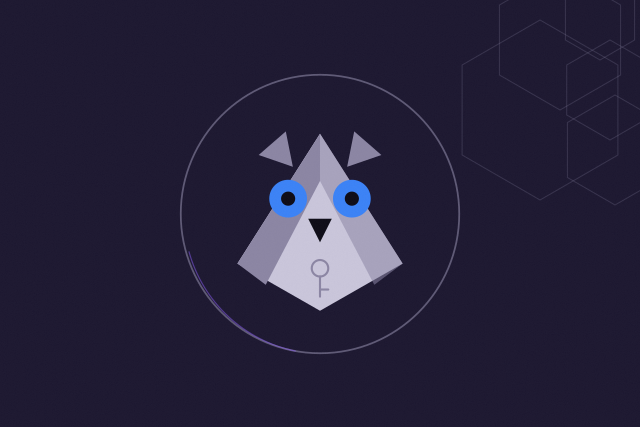

# Hedwig

<p align="center">
  
</p>

<p align="center">
  <a href="LICENSE"></a>
</p>

> If AI is making it easier to transact onchain, we need to make it dramatically safer for everyone to use it.

**Know before it pays.**

Hedwig is a second opinion you ask before your AI agent pays. It is designed to assess the payment your agent has prepared, give you a report when you ask, and leave the call to you. Hedwig never signs or sends.

## Try Hedwig today

Open the install page at [usehedwig.xyz/agents](https://usehedwig.xyz/agents), or paste this line into your coding agent:

```
Help me install Hedwig. Open this exact link and follow its instructions: https://usehedwig.xyz/agents.md
```

Your agent asks you before it installs anything. It sets up release v0.4.2 on your computer as a local MCP server named `hedwig`. Before a payment or swap, the agent calls the `consult` tool. Hedwig compares the recipient, amount and chain with the limits you gave it, checks the token against its built-in list, and answers with its reasons. At v0.4.2 a limit cannot name a token, so size each limit in USDC base units; the same number applies to every token.

You need Git, Node.js 22 or newer, and Yarn. Your agent runs these install commands:

```sh
mkdir hedwig && cd ./hedwig && git init &&
git fetch --depth 1 https://github.com/gabchess/hedwig.git e85049bc7087f434fd732bb02e0e87ca57acd82c &&
git checkout FETCH_HEAD &&
test "$(git rev-parse HEAD)" = e85049bc7087f434fd732bb02e0e87ca57acd82c &&
yarn install --frozen-lockfile --ignore-scripts && npm ci --ignore-scripts --prefix mcp && yarn consult:build && yarn mcp:build
```

They fetch the exact v0.4.2 commit by its full hash and stop at the first failure. The [install guide](docs/agents.md) covers the rest: the limits file you write, how to register the server with your MCP client, and how the agent calls `consult`.

## The story

I started Hedwig on 12 June 2026 as a roles program for Solana. An organization creates a role, gives it to a wallet with an expiry, and can take it back later. Other programs call `check_role` before they act.

Then agents started holding wallets. I wanted the person behind the agent to know what a payment would do before it went out.

## The first tests

The first version, tag `hedwig-sol-v1`, had the six-instruction Anchor program, a small consumer program that calls `check_role`, and a TypeScript SDK. The program runs on Solana devnet as `H4J9wWhraK2Zvn4o9aFheFVmAf7nfaBNPw3d7w77X1eC`. Its source is at [tag v0.4.2](https://github.com/gabchess/hedwig/tree/v0.4.2/programs).

## The pivot

On 20 September 2026 I renamed the repo from `hedwig-sol` to `hedwig`. A wallet's role became one of several things Hedwig looks at before a payment. [`@hedwig/consult`](consult/README.md) holds that logic, and the [MCP server](mcp/README.md) lets an agent call it.

Release v0.4.2 followed on 30 September 2026. It is what the install page sets up today.

## Build and test

```sh
yarn install --frozen-lockfile --ignore-scripts
npm ci --ignore-scripts --prefix mcp
yarn consult:build && yarn mcp:build && yarn consult:test && yarn mcp:test
```

[usehedwig.xyz](https://usehedwig.xyz) · [Security](SECURITY.md) · [License (MIT)](LICENSE)
