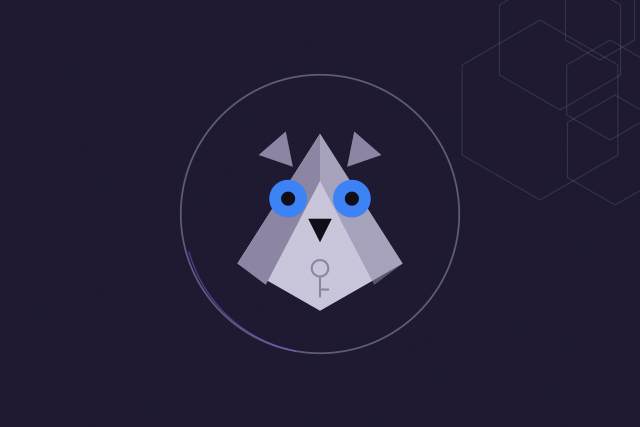

# Hedwig

**Know before it pays.**

<p align="center">
  
</p>

Hedwig checks a proposed payment or swap against an operator's payment policy before an agent pays. Its default `consult` tool reports whether those checks pass; your application controls signing and execution.

The separate, opt-in `ask_hedwig` tool explains blockchain, DeFi and onchain payment concepts using pinned reference sources. Its experimental foundations profile also compares documented Aave V3 and Compound III mechanisms. These answers do not authorize transactions or certify current deployment safety. See the [MCP guide](mcp/README.md) for supported scope, configuration and evidence limits.

## What it is

A second opinion for your AI agent's payments. Your agent asks Hedwig first. To see the reasons, ask for the report. Then you make the call.

## Who it is for

Anyone who lets an AI agent handle money, and the builders who connect agents to wallets.

## Why it matters

If AI is making it easier to transact onchain, we need to make it dramatically safer for everyone to use it. Agents move money faster than you can read the details. Hedwig checks before the payment, while a mistake is still free to fix.

## Try it

Paste this into your agent, or open [usehedwig.xyz/agents](https://usehedwig.xyz/agents):

```
Help me install Hedwig. Open this exact link and follow its instructions: https://usehedwig.xyz/agents.md
```

Built for the agent you already use. The [install guide](docs/agents.md) has every command.

## Add the plugin

```text
/plugin install hedwig --marketplace gabchess/hedwig
```

Needs your agent app at version 2.1.275 or later, and Node.js 22. See the [plugin guide](plugin/README.md).

## The story

I asked myself one question: would I trust an AI agent with my money? An agent might know how to make a payment. But did it understand what I wanted? Is it spending the right amount? Can it explain why?

Hedwig started in June 2026 as a roles program for Solana. Then agents started holding wallets, and it became the check your agent calls before it pays. [Watch the founder video](https://usehedwig.xyz/team/founder).

[usehedwig.xyz](https://usehedwig.xyz) · [Security](SECURITY.md) · [License (MIT)](LICENSE)
